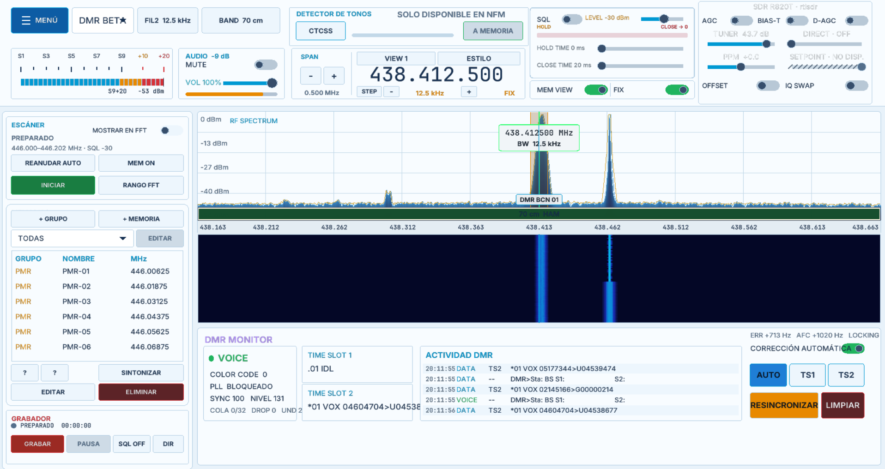
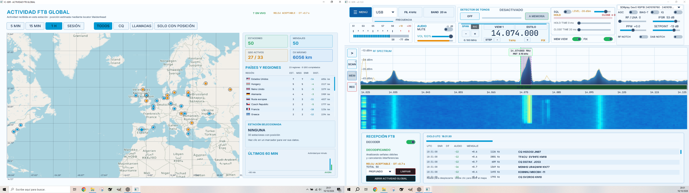
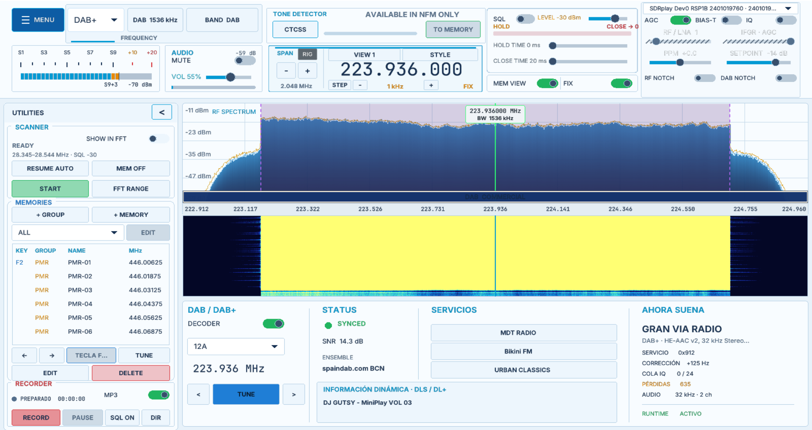
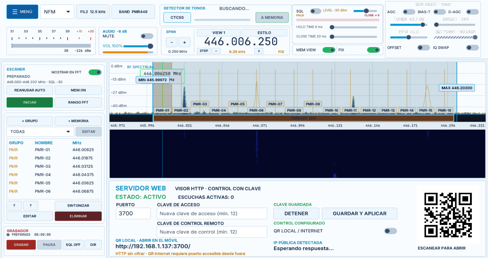
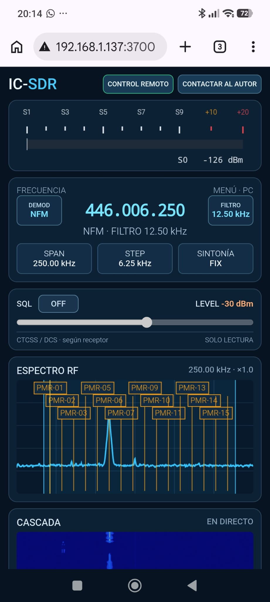
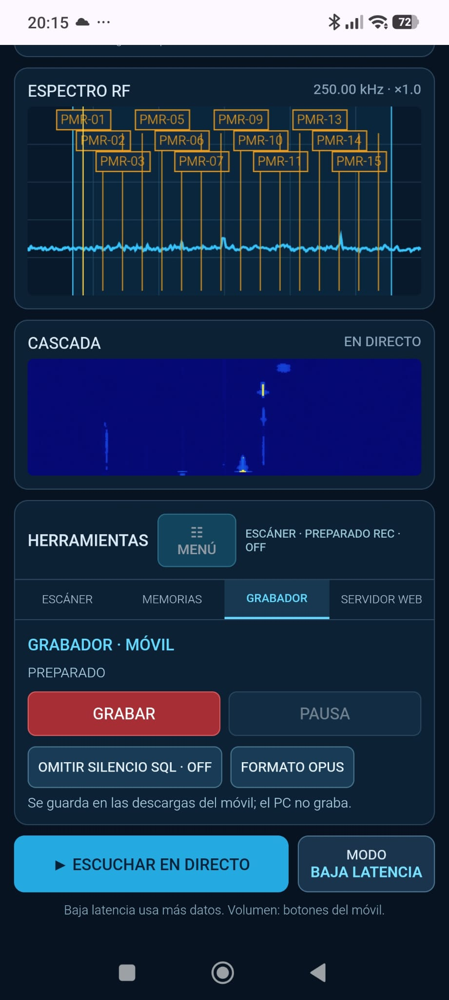

# IC-SDR

**SDR multimodo para Windows, programado en Go para ofrecer la máxima eficiencia.**

**Versión actual: [v0.24.0](https://github.com/LuislopezMartinez/IC-SDR/releases/tag/v0.24.0)**

IC-SDR reúne recepción, demodulación, análisis de espectro y decodificación de señales digitales en una interfaz de escritorio diseñada para el uso diario.

> [!IMPORTANT]
> IC-SDR está diseñado específicamente para **Windows**. El binario y todos los componentes necesarios para su distribución portable se encuentran en la carpeta `dist/IC-SDR-Go` después de generar el paquete.



## Características

- Demodulación en **AM, NFM, WFM, LSB y USB**.
- Soporte para modos digitales.
- Espectro y cascada en tiempo real.
- Banco de memorias organizado por grupos.
- Grabador de audio con eliminación automática de espacios en blanco.
- Escáner de segmentos de frecuencia con disparo instantáneo.
- Detector de tonos y control de squelch.
- Ecualizador de cinco bandas y controles de procesamiento de audio.

## Decodificadores

IC-SDR integra herramientas para recibir y visualizar:

- **AIS** — seguimiento de embarcaciones en los canales marítimos.
- **ADS-B** — recepción de aeronaves en 1090 MHz y UAT 978 MHz.
- **Radiosondas** — compatibilidad con RS41, DFM y M10/M20.
- **APRS** — recepción y visualización de paquetes.
- **RTL_433** — decodificación de sensores y dispositivos ISM, con exportación CSV.
- **DMR** — recepción de radio digital.
- **SSTV** — televisión de barrido lento.
- **DATV** — recepción de televisión digital amateur DVB-S y DVB-S2.
- **TETRA** — recepción y análisis de señales TETRA.
- **Digital Auto** — detección y decodificación de DMR, P25 I/II, NXDN,
  D-STAR, YSF, dPMR, ProVoice, M17 y X2-TDMA mediante DSD-neo.

## Capturas actuales







| Visor web en el móvil | Grabador y audio en directo |
| --- | --- |
|  |  |

## Novedades de v0.24.0

- Log de concursos enriquecido con identificación DXCC, bandera, zona CQ y hora local aproximada del corresponsal.
- Aviso preventivo de duplicados por banda o por concurso antes de guardar el QSO, con historial horario de los contactos previos.
- Tablas del log y visor reorganizados para mostrar DXCC y más contactos visibles sin recortes.
- Soporte de selección de antena para SDRplay **RSPduo**, incluidas las etiquetas Tuner 1 50 Ω, Tuner 1 Hi-Z y Tuner 2 50 Ω.
- Correcciones de estabilidad en la enumeración SoapySDR y en los campos de texto de la interfaz.

## Novedades de v0.23.0

- Nuevo terminal **POCSAG** para 512, 1200 y 2400 baud: tabla en directo, visor externo desplazable, copia, filtro y exportación CSV mediante `multimon-ng`.
- El runtime POCSAG de Windows x64, su licencia GPL y sus referencias de código fuente quedan incluidos en la distribución portable.
- Interfaz disponible también en francés, incluido como catálogo de respaldo en el ejecutable.
- Log de concursos ampliado con perfiles, validaciones y cálculo de puntuación más completos.
- Mejoras de estabilidad en el cambio de dispositivos y en la interfaz de herramientas.

## Novedades de v0.22.0

- Interfaz disponible también en alemán, con catálogo completo integrado en el ejecutable y traducción externa editable en `contenidos/de.json`.
- Corregida la transición de AGC a ganancia manual: RTL-SDR restaura la ganancia del sintonizador y Airspy restablece LNA, MIX y VGA aunque el valor solicitado coincida con la lectura anterior.
- Endurecida la sincronización durante la enumeración de dispositivos SDR para evitar estados de arranque inconsistentes.

## Novedades de v0.21.0

- Menú principal renovado con categorías, carrusel de herramientas, navegación por teclado y tarjetas visuales para localizar más rápido cada función.
- Recepción TETRAPOL más ágil: sigue los canales de tráfico dentro de la captura IQ sin resintonizar el hardware y acelera la detección de asignaciones CCH→TCH.
- Al cambiar manualmente de frecuencia se limpia correctamente el estado de red TETRAPOL, conservando solo los grupos GSSI configurados por el usuario.
- Audio TETRAPOL con menor búfer inicial, ecualización de presencia independiente y limitador específico, para una escucha más clara sin afectar al procesado general.

## Novedades de v0.20.0

- Compatibilidad integrada con **Airspy R2**, incluidos los componentes necesarios en la distribución portable para Windows.
- El flujo nativo de Airspy a 2,5 MS/s se adapta internamente a 2,048 MS/s con remuestreo complejo filtrado, manteniendo la compatibilidad con los demoduladores de IC-SDR.
- Nuevos controles específicos de Airspy: AGC, LNA, MIX, VGA y Bias-T, tanto en la cabecera SDR como en los ajustes detallados.
- El monitor TETRAPOL permite filtrar el seguimiento automático por **GSSI**: se pueden añadir grupos detectados o introducirlos manualmente; las llamadas cifradas no se siguen ni se decodifican.
- **Reportes y sugerencias** abre una incidencia en GitHub con diagnóstico técnico mínimo y sin enviar datos a servicios de formularios externos.

## Novedades de v0.19.0

- Nuevo motor **TETRAPOL nativo x64** integrado en IC-SDR: elimina la dependencia de procesos auxiliares para la recepción y deja el procesamiento de IQ, telemetría y audio dentro de la aplicación.
- Audio TETRAPOL mejorado mediante reconstrucción polifásica de 8 a 48 kHz, con menos imágenes espectrales y una respuesta de voz más natural.
- Seguimiento CCH→TCH más fiable: conserva el contexto de celda/canal, vuelve al canal de control al finalizar una sesión y no prolonga una llamada por telemetría sin audio.
- Panel TETRAPOL renovado con vistas de estado, conversación y diagnóstico; incorpora métricas de sincronismo, AFC, colas IQ, CRC, PLC y audio.
- La distribución portable incluye el motor nativo necesario y valida su presencia durante la compilación de la release.

## Novedades de v0.18.0

- Nuevo acceso de **Reportes y sugerencias** desde el menú principal.
- Mejoras de QRZ Callbook: muestra y activa correctamente la ventana de inicio de sesión cuando hace falta, impide interpretar páginas sin autenticar como perfiles y reconoce más variantes del locator.

## Novedades de v0.17.2

- Corregido el seguimiento de llamadas **TETRAPOL**: conserva el span de espectro al pasar entre CCH y TCH, descarta la telemetría anterior tras una sintonía manual y limpia el aviso de adquisición al recuperar sincronismo.
- La recepción directa de un TCH ya no bloquea audio por falta de metadatos de cifrado; las llamadas identificadas explícitamente como cifradas continúan protegidas. El panel muestra claramente si el audio está abierto, cifrado o aún sin identificar.

## Novedades de v0.17.1

- Corregido el actualizador automático: ahora acepta de forma segura los paquetes portables con los ejecutables en la raíz del ZIP y los paquetes con una carpeta raíz única.
- El paquete de transición mantiene una carpeta portable única, de modo que las instalaciones de v0.17.0 que mostraban el error de validación pueden instalar esta corrección automáticamente.

## Novedades de v0.17.0

- Nueva **Galería y editor SSTV** en ventana maximizable, con carrusel de imágenes, comparación original/mejorada mediante divisor móvil y exportación de copias sin modificar nunca la recepción original.
- Nuevas mejoras SSTV aplicables bajo demanda: corrección y balance de color, contraste, recuperación y alineación de filas, reducción de ruido y bandas horizontales, suavizado, nitidez y detección de contornos.
- Cada captura SSTV conserva ahora metadatos de calidad por línea, para que la recuperación de líneas funcione también al reabrir imágenes guardadas.
- El decodificador SSTV confirma VIS antes de sustituir una recepción y protege las recepciones automáticas con tiempos máximos por modo y un detector de falta de progreso. Las imágenes parciales se guardan y todos los receptores se reinician limpiamente tras pérdida de señal.
- Mejoras de legibilidad y distribución del panel SSTV: historial ampliado, estados sin solapes, vista previa proporcional y contador del límite de recepción.

## Novedades de v0.16.0

- Nuevo decodificador **DATV** para DVB-S y DVB-S2, con sintonía de canal, tasa de símbolos, FEC, polaridad y detección automática.
- Análisis de flujo MPEG-TS con identificación de códecs de vídeo y audio, control AFC y grabación de transporte.
- Reproducción de vídeo DATV integrada mediante VLC incluido en la distribución de Windows, junto al runtime LeanDVB/LDPC validado.
- Mejoras de interfaz para superponer y ajustar el canal DATV directamente sobre el espectro.

## Novedades de v0.15.1

- Corregida la sintonía desde el panel de satélites: respeta los modos **FIX** y **CENTER**, mantiene visible el objetivo cuando es posible y desplaza la captura IQ solo cuando hace falta.
- La sintonía de una señal satelital selecciona ahora su demodulador recomendado, con pruebas adicionales de regresión.

## Novedades de v0.15.0

- Nuevo comparador de imágenes **SSTV** para revisar la captura original y su versión mejorada, con divisor ajustable, zoom y acceso a la carpeta de salida.
- Mejora de SSTV: corrección conservadora de filas, reconstrucción de huecos cortos y reducción de ruido impulsivo, manteniendo siempre intacta la imagen original.
- El decodificador FT8 detecta pausas y desfases de audio, resincroniza la captura y espera el siguiente ciclo UTC completo para evitar decodificaciones desplazadas.
- El mapa FT8 amplía la identificación visual de entidades DXCC mediante banderas específicas.
- Ajustes de nivel y dinámica para mejorar la escucha de AM débil, junto con correcciones de estabilidad en audio e interfaz.

## Novedades de v0.14.1

- Los mapas de distancia y la actividad FT8 muestran la **hora local** de cada estación a partir de sus coordenadas, con zona horaria IANA y ajuste automático de horario de verano.
- Mejora de fiabilidad al resolver zonas horarias geográficas, sin necesidad de conexión de red y compatible con la distribución portable de Windows.

## Novedades de v0.14.0

- Nuevo decodificador **FT8** con sincronización de ciclos UTC, niveles de profundidad y vista de mensajes recibidos.
- Nueva vista de actividad FT8 global: mapa interactivo, locators Maidenhead, rutas, países/regiones DXCC, banderas y filtros de actividad.
- El runtime portable de FT8, basado en `ft8mon` y FFTW, se incluye en la distribución de Windows x64 con sus avisos de licencia.
- TETRAPOL mejora la telemetría de red, el seguimiento de canal y la continuidad de audio ante tramas perdidas.
- El panel SSTV ofrece una presentación ampliada de candidatos y mejoras de estabilidad en recepción.
- Correcciones adicionales en reproducción de audio, FFT, ajustes de aplicación y controles de interfaz.

## Novedades de v0.13.0

- Nuevo historial ampliado de actividad **DMR**, con seguimiento en directo, filtros por *time slot*, selección, copia y limpieza de eventos.
- Nuevos controles guiados para FFT, cascada y audio, con textos de ayuda integrados y una interfaz más clara.
- Reducción de ruido de audio mejorada: control de intensidad, velocidad de adaptación y pruebas de procesamiento ampliadas.
- Corregidos ajustes de TETRAPOL al resintonizar manualmente, evitando que la telemetría y el historial del canal anterior se mantengan en la nueva frecuencia.
- Mejoras de estabilidad y presentación en los paneles de DMR, QRZ, FFT, audio y fuentes de interfaz.

## Novedades de v0.12.0

- Nueva herramienta **QRZ Callbook**: consulta de indicativos desde una ventana integrada, con ficha de estación, foto, bandera y datos de ubicación.
- Nuevo mapa de distancia para los resultados de QRZ, con rutas corta y larga entre la estación local y la consultada.
- La sesión de QRZ se guarda fuera de la carpeta portable, en el perfil local de Windows: las cookies y credenciales no se incluyen al compartir ni al publicar una distribución.
- El receptor SDR detecta flujos de muestras detenidos y recupera automáticamente la captura, con reintentos controlados.
- El runtime DAB se asocia al proceso principal de Windows para que se cierre también si IC-SDR termina de forma inesperada.
- La utilidad de comprobación IQ admite duración, resintonía y frecuencia desde línea de comandos para diagnósticos más completos.

## Novedades de v0.11.1

- El decodificador DAB/DAB+ muestra información dinámica **DLS/DL+** emitida por las emisoras, como títulos, noticias y comentarios cuando estén disponibles.
- El panel DAB+ presenta el códec de audio, el identificador del servicio y una vista mejorada de los servicios y metadatos recibidos.

## Novedades de v0.11.0

- Nuevo decodificador y reproductor **DAB/DAB+**, con selección de canales de banda III y servicios digitales.
- Nuevo **Libro de concursos** con plantillas, control de duplicados, puntuación y exportación Cabrillo/ADIF.
- Nueva reducción de ruido de audio configurable para AM, NFM, USB, LSB y CW.
- Mejoras de temas, cabecera SDR, utilidades, control web y mapa VOACAP.
- Correcciones de estabilidad en audio, escáner, OmniRig, filtros y menús desplegables.

## Novedades de v0.10.1

- Corregida la preparación del runtime portable de VOACAP: se recrean sus directorios de trabajo necesarios para los cálculos de cobertura y rutas DX.

## Novedades de v0.10.0

- Nueva herramienta **Propagación DX · VOACAP** para predicciones HF locales, mapa de cobertura y cálculo de rutas entre estaciones.
- Integración del motor portable VOACAP 08.0121W, con configuración de estación, bandas, potencia, antena, ruido, hora UTC y datos solares NOAA.
- Mejora importante del nivel de escucha USB/LSB: ganancia adaptativa para señales débiles, compresión y limitador de seguridad.
- Controles independientes de suelo y techo FFT, con el umbral de squelch conservado al ajustar el rango visual.
- Correcciones de interfaz y estabilidad en menús desplegables, mapa de propagación y procesamiento de audio.

## Novedades de v0.9.4

- Nuevo modo **BYPASS NFM** en el monitor de voz digital: permite escuchar NFM mientras no hay voz decodificada y conmuta automáticamente al audio digital cuando llega.
- OmniRig mejora la apertura de su configuración avanzada y recupera ventanas minimizadas u ocultas, con mensajes de estado más claros.
- Nueva ventana **Acerca de** con versión, fecha de compilación, revisión Git y plataforma; los datos se pueden copiar al portapapeles para soporte técnico.
- Las compilaciones de distribución incorporan versión, revisión y fecha de creación en la aplicación y en el registro de inicio.
- Los procesos auxiliares de Windows, incluida la conversión MP3, ya no muestran ventanas de consola.
- Correcciones de estabilidad en el audio digital, RTL_433, grabación y actualización automática.

## Novedades de v0.9.3

- Nuevo filtro *notch* de audio ajustable, con detección automática de tonos, ancho y profundidad configurables.
- El escáner conserva y muestra los límites de segmentos fuera de la vista FFT; permite centrar cada extremo o ajustar el FFT al segmento completo.
- CAT OmniRig más fiable con perfiles VFO A/B, confirmación de sintonía y reintentos ante lecturas antiguas.
- Nuevo paso de sintonía de 500 Hz y mejoras visuales en el ancho de demodulación y el panel de audio.
- Correcciones de estabilidad y cobertura adicional de pruebas para audio, escáner y OmniRig.

> [!NOTE]
> Esta versión permite comprobar el flujo de actualización automática desde la v0.9.2.

## Novedades de v0.9.2

- Actualizador integrado funcional para instalaciones portables de Windows:
  descarga el paquete estable, verifica SHA-256, valida su contenido y aplica
  la actualización mediante un asistente externo antes de reiniciar IC-SDR.
- Indicador de progreso durante la descarga y cierre ordenado de la aplicación
  para liberar el receptor y los archivos antes de la sustitución.
- El paquete de distribución incluye `IC-SDR-Go.exe` e `IC-SDR-Updater.exe`.

> [!NOTE]
> La comprobación completa de actualización automática se realizará desde una
> versión posterior, por ejemplo v0.9.3.

## Novedades de v0.9.1

- Accesos rápidos F1–F12 asignables a memorias, con reasignación segura,
  confirmación visual y disponibilidad desde cualquier herramienta.
- Control de volumen con curva logarítmica para un ajuste más fino a niveles
  bajos y medios, y espectro de audio más fluido y optimizado.
- RTL_433 en modo FIX conserva la captura mientras la frecuencia siga visible
  y desplaza solo lo imprescindible.
- Corregida la posición del control de captura IQ Wavecom en el panel TETRA.
- Los deslizadores aplican correctamente los cambios hechos con la rueda del
  ratón. Ajustes adicionales de interfaz, persistencia y pruebas.

## Novedades de v0.9.0

- Nuevo monitor **TETRAPOL** experimental: perfiles VHF/UHF, canales CCH/TCH,
  enlace ascendente o descendente, seguimiento de tráfico y registro de eventos.
- Reproducción de audio únicamente para comunicaciones identificadas como no
  cifradas, y captura de IQ WAV a 128 kS/s con metadatos para análisis externo.
- Integración **OmniRig CAT** para RIG1/RIG2: seguimiento de frecuencia,
  sincronización bidireccional, modos de radio y silenciamiento de audio en TX.
- Predicción de satélites con SGP4 y renovación periódica del catálogo orbital.
- Perfiles por banda que conservan span, paso, escalas, FFT y ajustes de cascada.
- Sintonía directa coherente en espectro y cascada; RTL_433 en modo FIX solo
  recentra la captura cuando el canal queda fuera de la zona útil.
- Correcciones de estabilidad en cambios manuales de frecuencia, filtros,
  persistencia de preferencias y disposición de controles.

> [!NOTE]
> Las funciones TETRAPOL e IQ se destinan exclusivamente a la recepción y el
> análisis autorizados de señales.

TETRAPOL utiliza un motor liliPOL nativo de 64 bits integrado en la aplicación.
La distribución portable incluye su DLL autorizada en
`DATA/tools/tetrapol/native`.

## Novedades de v0.8.0

- Monitor TETRA con pestaña de señalización, hasta 1.000 eventos, detalle hexadecimal y exportación JSON.
- Mejoras SDS/TETRA: mensajes SDS-TL, localización, LIP, NMEA y mapa GPS por SSI.
- Audio WFM con filtrado antialias y limitador transparente; procesamiento general menos saturado.
- Grabación directa desde el demodulador y exportación MP3 a 160 kb/s mediante LAME.
- Controles completos para HackRF: LNA, VGA, amplificador y Bias-T.
- Las memorias restauran el módulo activo y el escáner recupera memorias sin interferir con la interfaz.
- Comprobación de nuevas versiones desde el menú.

## Novedades de v0.7.0

- Interfaz en español e inglés y traducciones ampliables sin recompilar.
- Mapa APRS independiente con símbolos y detalles de estaciones.
- Herramienta Distancias con ubicaciones guardadas, locators, rumbos, perfil del terreno y análisis aproximado de enlace y Fresnel.
- Selector de receptores conectados, dispositivo preferido, integración de HackRF Pro y antenas de SDRplay RSP-Dx según el controlador.
- Mapas con cartografía por teselas, proyección Mercator, caché y respaldo local.
- Catálogo ampliado de frecuencias de satélites con actualización desde SatNOGS.
- Correcciones de posiciones ADS-B, cobertura multicanal y optimización IQ en RTL_433, controles de audio/PBT y selección de filas.

## Novedades de v0.6.0

- Nuevo visor web para móviles con espectro, cascada, S-meter, memorias,
  escáner y estado de los decodificadores DMR/TETRA.
- Audio en directo por la red local: PCM de baja latencia u Ogg/Opus para
  ahorrar datos. Grabación opcional en el propio navegador móvil.
- Control remoto opcional, protegido con una segunda contraseña y limitado a
  una sesión: sintonía, filtros, squelch, escáner, memorias y DMR/TETRA.
- Configuración del servidor desde la aplicación y código QR para conectarse
  desde el móvil. Correcciones de interfaz y pruebas de los controles web.

> [!WARNING]
> El servidor web utiliza **HTTP sin cifrar**. Úsalo solo en una red local de
> confianza; no abras el puerto a Internet ni reutilices contraseñas de otros
> servicios. Consulta [la guía del visor web](docs/web-lan.md) antes de activarlo.

## Novedades de v0.5.0

- Visor TETRA/SDS ampliado con SSI de origen y destino, slot, cifrado,
  protocolo, tipo de datos y diagnóstico del contenido recibido.
- Conservación y visualización hexadecimal de mensajes SDS todavía no
  interpretados, facilitando el análisis de protocolos adicionales.
- Cabecera reorganizada con acceso directo a menú, vista, estilo y controles
  para aumentar o reducir el paso de sintonía.
- Área inferior aprovechada por completo y vistas simplificadas para mejorar
  la legibilidad de los módulos y decodificadores.
- El filtro NFM personalizado admite ahora anchos desde 500 Hz.
- Corregido el desplazamiento del catálogo de satélites para poder alcanzar
  todos los elementos y grupos de la lista.
- Correcciones en la restauración de vistas, memorias y pasos de sintonía.
- Nuevas pruebas para SDS/TETRA, disposición de la cabecera, sintonía, filtros
  y desplazamiento del mapa de satélites.

## Novedades de v0.4.0

- Nuevo decodificador **Digital Auto** con selección simultánea de protocolos,
  detección de llamadas y reproducción de voz digital.
- Panel dedicado con protocolo, slot, origen, destino, estado de cifrado,
  nivel de entrada, SNR, BER y datos específicos de la red.
- Predicción de próximas pasadas de satélites con AOS, máxima aproximación,
  LOS, elevación máxima y distancia mínima.
- Reinicio seguro de decodificadores, audio y escáner al cambiar de banda o
  modo, evitando audio residual y estados bloqueados.
- Correcciones en la reproducción al alternar entre audio analógico y digital.
- Corrección de la selección visual de dígitos en el control de frecuencia.
- Mejoras de contraste y legibilidad en el medidor de señal y el escáner.
- Validación del runtime DSD-neo 2.9.0 al construir la distribución portable.
- Nuevas pruebas para voz digital, predicción orbital, receptor y reproducción.

## Novedades de v0.3.1

- Nuevo módulo de seguimiento de satélites con catálogo TLE actualizado desde CelesTrak.
- Mapa mundial con posición, órbita, visibilidad y detalles de los satélites.
- Búsqueda, agrupación y sintonización de las frecuencias asociadas a cada satélite.
- Grabación de audio en **MP3 o WAV**, seleccionable desde la interfaz.
- Grabador renovado con medidor de nivel, historial, reproducción y eliminación de archivos.
- Mejoras en la omisión automática de silencios mediante squelch.
- Ajustes visuales y de usabilidad en memorias, escáner y menú de herramientas.
- Nuevas pruebas para satélites, grabación y marcadores de memoria.

## Novedades de v0.2.1

- Nuevos temas visuales y mejoras de contraste y legibilidad en toda la interfaz.
- Gestión de memorias ampliada con descripciones, prioridades, colores y edición de grupos.
- Nuevos presets para bandas aeronáuticas, marítimas e ISS/ARISS.
- Mejoras en el modo SSTV automático y selección de modos candidatos.
- Rediseño y ajustes de usabilidad en los paneles de audio, escáner, grabador y utilidades.
- Nuevas pruebas para temas, contraste, memorias y SSTV.

## Windows y distribución portable

IC-SDR está pensado para ejecutarse en Windows. La carpeta local `dist/IC-SDR-Go` contiene el binario distribuible `IC-SDR-Go.exe`, sus runtimes y las herramientas auxiliares necesarias. El directorio `DATA` debe permanecer junto al ejecutable.

La carpeta `dist/` se genera localmente y no forma parte del código fuente versionado. Para reconstruirla se utiliza `build-release.ps1`.
Los runtimes y herramientas auxiliares se conservan localmente en `DATA/runtime`, `DATA/tools` y `DATA/data`. El script los copia desde ahí y ya no necesita `ORIGEN`. Estos binarios no se incluyen en Git; un clon nuevo debe disponer de ellos antes de generar una release.

## Requisitos

- Windows.
- Go 1.27 o posterior para compilar desde el código fuente.
- Un receptor compatible con RTL-SDR, SDRplay (incluido RSP-Dx), HackRF Pro o Airspy R2.

El selector SDR detecta los equipos conectados. En RSP-Dx muestra las antenas que expone el controlador y permite cambiar entre ellas durante la recepción. En Windows, HackRF Pro requiere que el dispositivo tenga instalado un controlador USB compatible con libusb/WinUSB. Airspy R2 utiliza su flujo nativo de 2,5 MS/s, adaptado internamente a la tasa de procesamiento de IC-SDR, y ofrece controles LNA, MIX, VGA, AGC y Bias-T. La distribución portable incluye los módulos y bibliotecas de HackRF y Airspy junto al runtime SoapySDR.

## Compilación

Desde la raíz del repositorio:

```powershell
go build .
```

Para generar la distribución portable de Windows:

```powershell
powershell -ExecutionPolicy Bypass -File .\build-release.ps1
```

La distribución se crea en `dist/IC-SDR-Go`. Consulta [DISTRIBUTION.md](DISTRIBUTION.md) para obtener más información sobre el paquete portable y los directorios de datos.

## Datos y configuración

Los ajustes, memorias, grabaciones, capturas, exportaciones y registros se almacenan bajo `DATA`. Los datos generados durante el uso no se incluyen en el repositorio.

## Estado del proyecto

IC-SDR se encuentra en desarrollo activo. Las funciones disponibles pueden variar según el receptor, los controladores y las herramientas de decodificación instaladas.

El menú permite elegir Español o English. Los archivos de traducción se distribuyen en `contenidos` junto al ejecutable y se descubren al arrancar. Para añadir idiomas o corregir textos, consulte [contenidos/LEEME.md](contenidos/LEEME.md).

El menú incluye **Distancias**, que abre un mapa independiente con dos pins arrastrables, un panel movible y una lista de ubicaciones que permite añadir, editar, eliminar y asignar lugares a A o B. La lista se guarda en `DATA/config/distance-locations.json`.

El panel muestra distancia aproximada sobre una Tierra esférica, coordenadas, locator Maidenhead, rumbos en ambos sentidos y elevaciones del terreno. **Perfil y enlace** permite introducir frecuencia en MHz y alturas de antenas sobre el terreno en metros; muestra pérdida en espacio libre, línea de vista y despeje del 60% de la primera zona de Fresnel. La gráfica usa verde para el relieve, naranja para la línea de vista y azul para el límite inferior del 60% de Fresnel, con curvatura terrestre y radio efectivo k=4/3.

Las elevaciones proceden de [Mapzen mediante Open Topo Data](https://www.opentopodata.org/), con 81 muestras por recorrido y consulta en segundo plano al terminar de arrastrar un pin. La resolución efectiva del perfil depende de la distancia entre muestras y del modelo de elevaciones; no garantiza detectar todos los obstáculos y no incluye edificios ni árboles. Sin conexión, distancia, coordenadas, rumbos, locators y pérdida en espacio libre siguen funcionando; las elevaciones no disponibles se identifican explícitamente. Los mapas utilizan el cargador compartido de tiles y su respaldo local.

El monitor TETRA incluye una pestaña **Señalización**, separada de los mensajes SDS. Conserva el identificador de llamada, SSI del recurso, participante, portadora, máscara de slots asignados, slot de recepción, concesión de transmisión y campos de servicio/opciones presentes en D-SETUP, D-CONNECT, D-TX-GRANTED, D-INFO, D-TX-CEASED y D-RELEASE. Los campos se contrastaron con la DLL del plugin SDRSharp proporcionada para análisis; no se incorpora esa DLL al programa.

El visor permite recorrer los últimos 1000 eventos, seleccionar una fila y consultar el detalle y los bits originales en hexadecimal con desplazamiento. **Exportar JSON** guarda todos los eventos retenidos de la pestaña activa en `DATA/exports/tetra`. El slot de recepción y la máscara de asignación son datos diferentes; esta última se presenta en hexadecimal.

SDS interpreta además mensajes de texto con cabecera SDS-TL (130 y 137), localización en texto (3 y 131) y cabeceras de control LIP extendidas. Las posiciones cortas LIP y las sentencias NMEA RMC/GGA válidas se conservan por SSI y se muestran en el mapa GPS con tiles y respaldo local. Un mensaje NMEA sin posición válida no crea un marcador. Los subtipos, codificaciones y contenidos todavía no interpretados conservan su hexadecimal; no se inventan coordenadas ni valores de movimiento ausentes. Los formatos LIP largos no se presentan como posiciones decodificadas.

La validación incluye tramas sintéticas completas MAC → LLC → CMCE → evento, campos opcionales, mensajes truncados, SDS-TL, posiciones NMEA y separación entre SDS y señalización. La recepción de una emisión concreta requiere comprobar después una grabación IQ o una señal en directo; los textos de SDRSharp por sí solos no permiten validar la demodulación.

Cada memoria guarda el identificador del **tool activo** en el campo opcional `tool`. Al crear o editar una memoria desde la aplicación o el control web se utiliza el tool activo en ese momento. Al sintonizarla, el tool se restaura antes del modo, filtro, paso y frecuencia. Las memorias antiguas sin este campo siguen siendo válidas y conservan el comportamiento anterior, incluido el acceso automático a DMR para memorias DMR heredadas.
